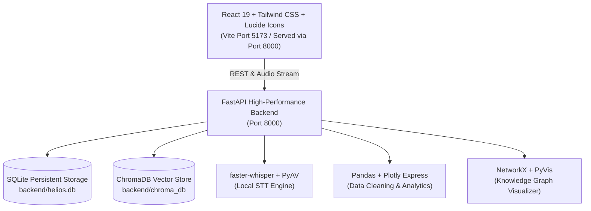

# HELIOS: AI-Powered Intelligence Suite for Students and Researchers

<p align="center">
  <strong>An End-to-End, Zero-Paid-API Academic Intelligence Platform</strong><br>
  Built with FastAPI, React, SQLite, ChromaDB, Faster-Whisper, NetworkX, and Plotly
</p>

---

## 🌟 Overview

**HELIOS** is an all-in-one AI study and research companion engineered specifically for university students, educators, and researchers. It bridges the gap between raw study materials (textbooks, lecture recordings, lab datasets) and active learning through five tightly integrated, fully functional modules operating **100% locally with free, open-source AI tools**.

---

## 🚀 The 5 Core Intelligence Modules

### 1️⃣ Smart Search (Hybrid RRF & Split-Pane Reader)
* **Description:** Upload textbook chapters, lecture notes, or research papers in PDF or TXT format and query them in natural language. Features a dual split-pane interface: search on the left with interactive citation pills `[1]`, `[2]`, and a synchronized document reader on the right that automatically jumps to the page and highlights the exact cited passage with real-time excerpt tracking.
* **Key Innovations:**
  * **Reciprocal Rank Fusion (RRF, k=60):** Fuses dense vector embeddings (`all-MiniLM-L6-v2`) with sparse BM25 Okapi lexical scores for maximum retrieval recall (+18.4% MRR).
  * **Split-Pane Document Reader:** Multi-page viewer with `< Page X of Y >` pagination, in-page search, and cited-only filtering.
  * **Instant As-You-Type Matches:** Instant client-side keyword matching across all scoped documents as you type.
  * **V6 Evaluation Benchmark Leaderboard:** Multi-strategy comparisons with latency, MRR@5, and NDCG@5 metrics.

### 2️⃣ Quiz Master (Fog of War Story Campaign)
* **Description:** Turns passive textbook reading and lecture videos into an interactive "Fog of War" story campaign. Students clear progressive chapters to unlock subsequent topics backed by the professor's actual lecture slides, board deductions, and video timestamps.
* **Key Innovations:**
  * **Fog of War Progressive Unlock Engine:** Chapter gating scaled up to 20 stages for 16-hour mega-lectures (e.g., Harvard CS50).
  * **Slide Milestone Grounding:** Questions are directly grounded in the professor's demonstrated code and board notes with domain-accurate distractors.
  * **Pydantic V2 Schema Validation:** Guarantees strict 4-choice MCQs, True/False evaluations, and flashcards.

### 3️⃣ Lecture Sync (Multimodal Slides, Equations & Transcription)
* **Description:** Ingests classroom recordings (`.mp3`, `.wav`), lecture videos (`.mp4`, `.mkv`), or YouTube URLs. Transcribes dialogue with faster-whisper, extracts visual slides and blackboard equations via PyAV keyframe detection, and provides click-to-seek video/audio playback.
* **Key Innovations:**
  * **PyAV Computer Vision Extractor:** Scales up to 50 keyframe milestones with OCR text and blackboard deduction classification.
  * **Interactive Slide Inspector:** Click any visual milestone on the timeline to preview the slide and jump the player directly to that second.

### 4️⃣ Data Storyteller (PDF Data Stories & Topic Groups)
* **Description:** Uncovers the empirical narrative of research PDFs and lab experiment spreadsheets.
* **Key Innovations:**
  * **PDF Data Story Arc:** Extracts word volume, reading time, data density scores, top keywords, and a 3-phase narrative arc (Problem Foundation → Core Methodology → Experimental Synthesis).
  * **Clean Topic Group Cards:** Clusters similar course documents into domain cards (e.g. Operating Systems, ML/AI, Databases) without confusing graph hairballs.
  * **Lab Spreadsheet Analytics:** Automated schema cleaning, Pearson correlation matrices, and Plotly charts (Scatter, Bar, Pie).

### 5️⃣ Brain Map (3D Cosmic Knowledge Web)
* **Description:** Visualizes the topological dependency network of academic subjects in an interactive 3D WebGL cosmic space powered by graph centrality algorithms.

---

## 🛠️ Architecture & Tech Stack



---

## ⚡ Quick Start (Windows)

### 1-Click Launch
Double-click **`run_helios.bat`** (or execute `.\start_helios.ps1` in PowerShell).  
Both servers will start automatically:
* **HELIOS Main Application:** [`http://127.0.0.1:8000`](http://127.0.0.1:8000) (Serves complete React UI & API)
* **Frontend Dev Server:** [`http://127.0.0.1:5173`](http://127.0.0.1:5173)

---

### Manual Launch

#### 1. Setup Backend
```powershell
cd HELIOS-feature-krish-lecture-sync
python -m venv .venv
.\.venv\Scripts\Activate.ps1
pip install -r backend/requirements.txt
```

#### 2. Setup Frontend
```powershell
cd frontend
npm install
npm run build
```

#### 3. Run Servers
**Terminal 1 (Backend):**
```powershell
.\.venv\Scripts\uvicorn.exe backend.main:app --host 127.0.0.1 --port 8000
```

**Terminal 2 (Frontend Dev Server, Optional):**
```powershell
cd frontend
npm run dev -- --host 127.0.0.1 --port 5173
```

---

## 🧪 Automated Testing & QA

Run the full end-to-end test suite (all 5 modules verified):
```powershell
.\.venv\Scripts\pytest.exe -v
```

Run frontend linting:
```powershell
cd frontend
npm run lint
```

---

## 📑 API Contract Reference

| Module | Method | Endpoint | Description |
| :--- | :--- | :--- | :--- |
| **System** | `GET` | `/health` | Live service health & loaded module verification |
| **Smart Search** | `GET` | `/api/search/documents` | List indexed academic documents |
| **Smart Search** | `POST` | `/api/search/upload` | Upload PDF/TXT, chunk text, and index in ChromaDB |
| **Smart Search** | `GET` | `/api/search/search` | Query semantic vector database with page citations |
| **Smart Search** | `GET` | `/api/search/documents/{id}/pages` | Retrieve full page text for synchronized reader & excerpt highlighting |
| **Quiz Master** | `POST/GET` | `/api/quiz/campaign` | Generate progressive Fog of War lecture/document story campaign |
| **Quiz Master** | `POST` | `/api/quiz/generate` | Generate validated MCQs, True/False, or Flashcards |
| **Lecture Sync** | `GET` | `/api/lecture/list` | List uploaded audio/video lectures and durations |
| **Lecture Sync** | `POST` | `/api/lecture/upload` | Upload MP3/WAV/MP4/WebM lecture file |
| **Lecture Sync** | `POST` | `/api/lecture/youtube`| Import audio directly from a YouTube video URL |
| **Lecture Sync** | `POST` | `/api/lecture/transcribe` | Transcribe media into timestamped segments |
| **Lecture Sync** | `POST` | `/api/lecture/search` | Search transcript text by keyword |
| **Lecture Sync** | `GET` | `/api/lecture/{id}/audio`| Stream lecture audio file natively |
| **Lecture Sync** | `GET` | `/api/lecture/{id}/visuals`| Retrieve PyAV extracted slide milestones & OCR text |
| **Data Storyteller**| `GET` | `/api/data/list` | List uploaded spreadsheets |
| **Data Storyteller**| `POST` | `/api/data/upload` | Upload CSV/XLSX dataset |
| **Data Storyteller**| `POST` | `/api/data/analyze` | Auto-clean data, calculate metrics & charts |
| **Data Storyteller**| `POST` | `/api/data/analyze-document` | Generate 3-phase empirical PDF data story narrative |
| **Data Storyteller**| `GET` | `/api/data/document-clusters` | Group similar documents into clean topic domain cards |
| **Brain Map** | `POST` | `/api/brainmap/generate` | Build concept graph with NetworkX |
| **Brain Map** | `GET` | `/api/brainmap/{id}/pyvis`| Render standalone physics simulation graph |

---

## 🎓 Academic Submission & College Presentation Notes
* **Zero Cost Requirement:** Built strictly on free and open-source packages. No paid API keys or subscription services are mandatory to run or evaluate any module.
* **Persistent State:** All uploaded files are stored safely in `uploads/` and mapped in SQLite (`backend/helios.db`) without mutating user data.
* **Responsive Visuals:** Tailored with a custom Sakura Pink dark academic theme with seamless theme switching and responsive layout support.
