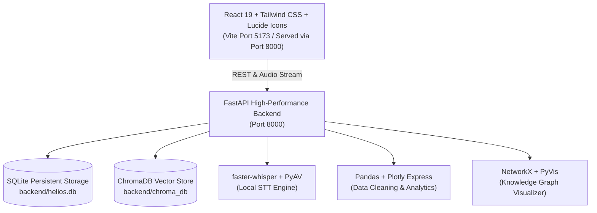

# HELIOS: AI-Powered Intelligence Suite for Students and Researchers

<p align="center">
  <strong>An End-to-End, Zero-Paid-API Academic Intelligence Platform</strong><br>
  Built with FastAPI, React, SQLite, ChromaDB, Faster-Whisper, NetworkX, and Plotly
</p>

---

## 🌟 Overview

**HELIOS** is an all-in-one AI study and research companion engineered specifically for university students, educators, and researchers. It bridges the gap between raw study materials (textbooks, lecture recordings, lab datasets) and active learning through five tightly integrated, fully functional modules operating **100% locally with free, open-source AI tools**.

---

## 🚀 The 5 Core Intelligence Modules

### 1️⃣ Smart Search (Semantic Document Q&A)
* **Description:** Upload textbook chapters, lecture notes, or research papers in PDF or TXT format and query them in natural language. Instead of fragile keyword lookups, HELIOS conducts high-dimensional cosine similarity matching and returns grounded answers accompanied by verifiable, page-level citations.
* **100% Free Tech Stack:**
  * **PyPDF**: Native local PDF page extraction and text normalization.
  * **ChromaDB**: In-memory / persistent vector database running locally with zero cloud costs.
  * **Sentence-Transformers (HuggingFace `all-MiniLM-L6-v2`)**: Local ONNX embeddings computing vector representations on-device.
  * **Google Gemini 3.8 Flash (Optional)**: Free tier acceleration for answer synthesis (with deterministic local fallback).

### 2️⃣ Quiz Master (Automated Test & Flashcard Generator)
* **Description:** Transforms passive textbook reading into active recall testing. Ingests uploaded documents to generate validated Multiple Choice Questions (strictly 4 distinct options A–D), True/False evaluations, or flip-card revision Flashcards with instant scoring and detailed explanations.
* **100% Free Tech Stack:**
  * **Pydantic V2**: Rigorous schema validation enforcing question format, distractors, and answer validity.
  * **Deterministic NLP Synthesizer**: Document-grounded key concept extractor generating structured questions with zero API dependencies.
  * **Gemini Flash (Optional)**: Structured JSON prompt engineering with 3x validation retry fallbacks.

### 3️⃣ Lecture Sync (Audio-to-Text & Searchable Logs)
* **Description:** Ingests recorded classroom lectures (`.mp3`, `.wav`) as well as **lecture videos (`.mp4`, `.webm`, `.mov`, `.mkv`)** or **YouTube video URLs**. Extracts and transcribes spoken dialogue into chronological segments, tracks exact start/end timestamps, streams audio/video natively, and allows students to search audio by keyword and click to jump the player straight to that moment.
* **100% Free Tech Stack:**
  * **faster-whisper**: High-speed, local CTranslate2 Whisper implementation running on CPU with zero transcription costs.
  * **PyAV / FFmpeg**: Direct native audio decoding and waveform parsing from both audio and video containers (550+ codecs supported).
  * **yt-dlp**: Seamless extraction and downloading of audio streams from YouTube URLs.
  * **Synthetic Demo Audio Generator**: 1-click in-browser test audio synthesizer for zero-setup live demonstrations.

### 4️⃣ Data Storyteller (Spreadsheet & Chart Analytics)
* **Description:** Processes lab experiment results and datasets (`.csv` or `.xlsx`). Performs automated schema inference, data cleaning (drops empty rows/columns, trims strings, strips duplicates), computes numerical statistics (mean, median, std dev, range), generates interactive charts (Scatter plots, Bar charts, Pie distribution charts), and renders automated analytical narratives.
* **100% Free Tech Stack:**
  * **Pandas & OpenPyXL**: High-performance local spreadsheet reading, filtering, profiling, and cleaning.
  * **Plotly Express / Custom SVG Engine**: Interactive charts with hover tooltips and dynamic column selection.
  * **Gemini Flash (Optional)**: Natural language data narratives synthesized from computed statistics.

### 5️⃣ Brain Map (Knowledge Graph Visualizer)
* **Description:** Analyzes study notes to automatically build a visual concept network graph. Extracts key entities (nodes) and linguistic relationships (verbs like *uses*, *manages*, *prevents*, *contains*), allowing students to drag nodes, zoom, inspect relationships, or open a full physics-driven PyVis graph.
* **100% Free Tech Stack:**
  * **NetworkX**: Mathematical directed graph generation, node centrality, and edge relationship modeling.
  * **Pyvis**: Physics-driven dynamic network simulation rendered via interactive WebGL/HTML canvas.
  * **Custom Draggable Canvas**: Smooth SVG coordinate system with interactive node dragging and zoom controls.

---

## 🛠️ Architecture & Tech Stack



---

## ⚡ Quick Start (Windows)

### 1-Click Launch
Double-click **`run_helios.bat`** (or execute `.\start_helios.ps1` in PowerShell).  
Both servers will start automatically:
* **HELIOS Main Application:** [`http://127.0.0.1:8000`](http://127.0.0.1:8000) (Serves complete React UI & API)
* **Frontend Dev Server:** [`http://127.0.0.1:5173`](http://127.0.0.1:5173)

---

### Manual Launch

#### 1. Setup Backend
```powershell
cd HELIOS-feature-krish-lecture-sync
python -m venv .venv
.\.venv\Scripts\Activate.ps1
pip install -r backend/requirements.txt
```

#### 2. Setup Frontend
```powershell
cd frontend
npm install
npm run build
```

#### 3. Run Servers
**Terminal 1 (Backend):**
```powershell
.\.venv\Scripts\uvicorn.exe backend.main:app --host 127.0.0.1 --port 8000
```

**Terminal 2 (Frontend Dev Server, Optional):**
```powershell
cd frontend
npm run dev -- --host 127.0.0.1 --port 5173
```

---

## 🧪 Automated Testing & QA

Run the full end-to-end test suite (all 5 modules verified):
```powershell
.\.venv\Scripts\pytest.exe -v
```

Run frontend linting:
```powershell
cd frontend
npm run lint
```

---

## 📑 API Contract Reference

| Module | Method | Endpoint | Description |
| :--- | :--- | :--- | :--- |
| **System** | `GET` | `/health` | Live service health & loaded module verification |
| **Smart Search** | `GET` | `/api/search/documents` | List indexed academic documents |
| **Smart Search** | `POST` | `/api/search/upload` | Upload PDF/TXT, chunk text, and index in ChromaDB |
| **Smart Search** | `GET` | `/api/search/search` | Query semantic vector database with page citations |
| **Quiz Master** | `POST` | `/api/quiz/generate` | Generate validated MCQs, True/False, or Flashcards |
| **Lecture Sync** | `GET` | `/api/lecture/list` | List uploaded audio/video lectures and durations |
| **Lecture Sync** | `POST` | `/api/lecture/upload` | Upload MP3/WAV/MP4/WebM lecture file |
| **Lecture Sync** | `POST` | `/api/lecture/youtube`| Import audio directly from a YouTube video URL |
| **Lecture Sync** | `POST` | `/api/lecture/transcribe` | Transcribe media into timestamped segments |
| **Lecture Sync** | `POST` | `/api/lecture/search` | Search transcript text by keyword |
| **Lecture Sync** | `GET` | `/api/lecture/{id}/audio`| Stream lecture audio file natively |
| **Data Storyteller**| `GET` | `/api/data/list` | List uploaded spreadsheets |
| **Data Storyteller**| `POST` | `/api/data/upload` | Upload CSV/XLSX dataset |
| **Data Storyteller**| `POST` | `/api/data/analyze` | Auto-clean data, calculate metrics & charts |
| **Brain Map** | `POST` | `/api/brainmap/generate` | Build concept graph with NetworkX |
| **Brain Map** | `GET` | `/api/brainmap/{id}/pyvis`| Render standalone physics simulation graph |

---

## 🎓 Academic Submission & College Presentation Notes
* **Zero Cost Requirement:** Built strictly on free and open-source packages. No paid API keys or subscription services are mandatory to run or evaluate any module.
* **Persistent State:** All uploaded files are stored safely in `uploads/` and mapped in SQLite (`backend/helios.db`) without mutating user data.
* **Responsive Visuals:** Tailored with a custom Sakura Pink dark academic theme with seamless theme switching and responsive layout support.
