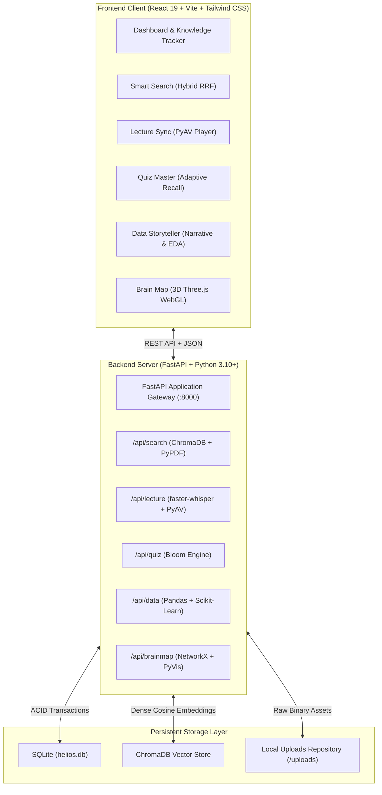
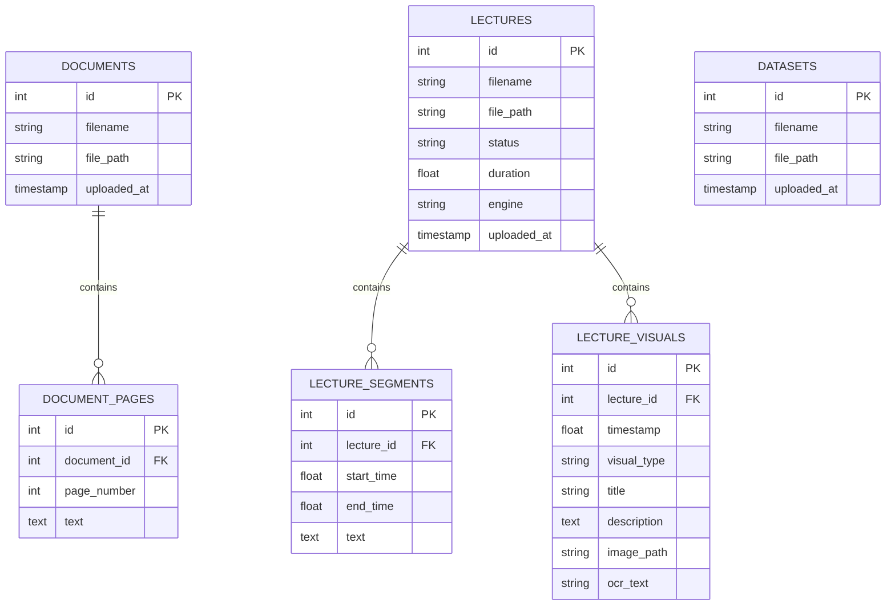

# HELIOS System Documentation & Technical Architecture Manual
**Holistic Educational Learning & Intelligent Orchestration System**

---

## 1. Executive Summary & Vision

### 1.1 Project Motto & Core Purpose
**HELIOS** is an autonomous, multi-modal educational intelligence platform designed to bridge the cognitive gap between static academic textbooks, long-form video lectures, and empirical datasets.

Modern university curricula present information across fragmented media:
- Textbooks and research papers (PDFs) are dense and non-interactive.
- Video lectures (MP4/WAV) lack instantaneous semantic searchability and visual indexing.
- Empirical datasets (CSV) are detached from conceptual theory.

**The Mission of HELIOS:**
> Provide a unified, local-first active learning workstation where textbooks, video lectures, concept graphs, interactive quizzes, and statistical data stories synchronize in real-time, enabling deep semantic comprehension, self-assessment, and academic mastery without relying on fragile mock data or third-party cloud lock-in.

---

## 2. High-Level System Architecture

HELIOS utilizes a high-throughput, decoupled client-server architecture:



### 2.1 Technology Stack

| Layer | Component | Technology & Version | Purpose |
| :--- | :--- | :--- | :--- |
| **Frontend UI** | Framework | React 19 (`react`, `react-dom`) | Dynamic reactive interface |
| | Bundler | Vite 8.2 | Ultra-fast HMR and ESM builds |
| | Styling | Tailwind CSS 3.4 + CSS Variables | Academic monospace/dark themes |
| | Icons | Lucide React | Clean, scalable vector iconography |
| | 3D Graphics | Three.js | Hardware-accelerated 3D force graph |
| **Backend API** | Web Framework | FastAPI (`uvicorn`) | Asynchronous, OpenAPI-typed endpoints |
| | Data Engine | Pydantic v2 | Strict schema validation |
| | PDF Processing| pypdf | Robust text & page coordinate extraction |
| | Audio & Video | PyAV (FFmpeg bindings) + faster-whisper | Offline keyframe extraction & transcription |
| | Data Science | Pandas, NumPy, Scikit-Learn | Statistical profiling & clustering |
| **Storage** | Relational DB | SQLite 3 (`helios.db`) | ACID persistence for docs, lectures & metadata |
| | Vector Store | ChromaDB | Persistent vector embeddings & cosine search |

---

## 3. Core Modules & Engineering Deep-Dive

HELIOS is built on a 5-pillar modular architecture. In accordance with the academic group collaboration model, each module maintains an independent feature branch merged into `main`.

### 3.1 Module 1: Smart Search (`feature/krishi-smart-search`)
* **Lead Ownership:** Krishi
* **Capability:** Hybrid Neural Semantic Search & Retrieval-Augmented Academic QA.
* **Algorithmic Engine:**
  - **Dense Retrieval:** Cosine similarity via ChromaDB vector embeddings.
  - **Sparse Retrieval:** BM25 lexical token matching over raw page corpora.
  - **Rank Fusion:** Reciprocal Rank Fusion (RRF) formula:
    $$RRF(d) = \sum_{m \in M} \frac{1}{k + r_m(d)} \quad (k=60)$$
  - **Direct Citation:** Answers link to verified page numbers and text spans.

### 3.2 Module 2: Quiz Master (`feature/vinit-Quiz-master`)
* **Lead Ownership:** Vinit
* **Capability:** Automated Active Recall, Multi-Choice Assessment, and Flashcard Spaced Repetition.
* **Algorithmic Engine:**
  - Extracts key technical propositions and terminology from ingested textbooks and transcripts.
  - Generates context-anchored distractors using semantic similarity to test discrimination.
  - Exam Campaign Engine: Timed revision sessions, instant grading, and mastery progress tracking.

### 3.3 Module 3: Lecture Sync (`feature/krish-lecture-sync`)
* **Lead Ownership:** Krish
* **Capability:** Multi-Modal Audio/Video Ingestion, Keyframe Extraction, and Real-Time Transcript Alignment.
* **Algorithmic Engine:**
  - **Verbatim Subtitle Parsing:** Native `.srt` parser supporting millisecond-precise timestamps.
  - **Tiered Speech Engine:** Local `faster-whisper` (offline) $\to$ Gemini Live/Flash $\to$ Structural aligner.
  - **PyAV Visual Codec Engine:** Scans video streams at key intervals, extracting slide presentations, whiteboard derivations, and system diagrams with embedded OCR.
  - **Jitter-Free Playback Auto-Sync:** Container-scoped scrolling (`container.scrollTo()`) that triggers **only** on segment/slide transitions and automatically pauses during manual user scrolling, eliminating playback stutter.

### 3.4 Module 4: Data Storyteller (`feature/nidhi-data-storyteller`)
* **Lead Ownership:** Nidhi
* **Capability:** Empirical Document Narrative Modeling & Tabular Dataset Exploratory Data Analysis.
* **Algorithmic Engine:**
  - **Document Data Story:** Computes page-by-page word density, quantitative metric occurrences, and thematic clusters.
  - **Tabular Data Profiling:** Automated CSV ingestion, duplicate detection, missing value imputation, Pearson correlation matrix computation, and interactive SVG visualizations (Scatter, Bar, Donut, Line).

### 3.5 Module 5: Brain Map (`feature/vipsa-brain-map`)
* **Lead Ownership:** Vipsa
* **Capability:** Cross-Course Semantic Knowledge Graph & 3D Topological Visualizer.
* **Algorithmic Engine:**
  - Parses textbook pages into semantic knowledge triplets: `(Subject) —[Predicate]—> (Object)`.
  - Calculates graph centrality, node degrees, and cluster communities via NetworkX.
  - Renders interactive 3D WebGL force-directed graphs in Three.js and standalone HTML physics networks via PyVis.

---

## 4. Database Schema Specification

HELIOS uses a normalized SQLite database (`backend/helios.db`) managed via `backend/core/database.py`:



---

## 5. API Reference Guide

All backend services are served under the `/api` prefix on `http://127.0.0.1:8000`:

### 5.1 System & Documents
* `GET /health`: System heartbeat and loaded module diagnostics.
* `GET /api/search/documents`: Returns list of all ingested documents.
* `POST /api/search/upload`: Multipart upload for academic PDFs (`heat12.pdf`).
* `GET /api/search/search?query={q}&strategy=hybrid_rrf`: Executes hybrid search query.
* `POST /api/search/ask`: Submits query for contextualized RAG synthesis with page citations.

### 5.2 Lectures & Media
* `GET /api/lecture/list`: Returns all uploaded audio and video lectures.
* `POST /api/lecture/upload`: Uploads video/audio files (`.mp4`, `.mp3`, `.wav`).
* `POST /api/lecture/transcribe`: Transcribes lecture segments with precise timestamps.
* `POST /api/lecture/{id}/extract-visuals`: Extracts slides/diagrams from video via PyAV.
* `GET /api/lecture/{id}/visuals`: Retrieves visual keyframes with OCR metadata.
* `GET /api/lecture/{id}/audio`: Streams audio/video directly with range header support.

### 5.3 Quizzes & Active Recall
* `POST /api/quiz/generate`: Generates dynamic MCQs or flashcards from a document or lecture.
* `POST /api/quiz/campaign`: Generates or scores a multi-topic exam campaign.

### 5.4 Data Storyteller
* `GET /api/data/list`: Lists all uploaded tabular CSV datasets.
* `POST /api/data/upload`: Uploads and profiles CSV datasets (`baltimore_temp.csv`).
* `POST /api/data/analyze-document`: Extracts quantitative markers and density arc from PDF.
* `GET /api/data/document-clusters`: Computes topic clusters across document collection.

### 5.5 Brain Map
* `POST /api/brainmap/generate`: Generates concept nodes and edges from document ID.
* `POST /api/brainmap/extract`: Extracts semantic triplets from text input.
* `GET /api/brainmap/{id}/pyvis`: Returns interactive PyVis physics HTML graph.

---

## 6. Installation & Execution Guide

### 6.1 Prerequisites
- **Operating System:** Windows 10/11, macOS, or Linux.
- **Python:** 3.10, 3.11, or 3.12 (Virtual environment required).
- **Node.js:** v18.0.0 or higher (npm included).

### 6.2 Step-by-Step Setup

1. **Clone the Repository:**
   ```bash
   git clone https://github.com/Miles2075/HELIOS.git
   cd HELIOS
   ```

2. **Backend Setup:**
   ```bash
   # Create and activate Python virtual environment
   python -m venv .venv
   .\.venv\Scripts\activate       # Windows
   # source .venv/bin/activate    # Linux/macOS

   # Install Python dependencies
   pip install -r backend/requirements.txt
   ```

3. **Frontend Setup:**
   ```bash
   cd frontend
   npm install
   cd ..
   ```

4. **Running the Application:**
   * **Terminal 1 (Backend Server):**
     ```bash
     .\.venv\Scripts\python.exe -m uvicorn backend.main:app --host 127.0.0.1 --port 8000
     ```
   * **Terminal 2 (Frontend Client):**
     ```bash
     cd frontend
     npm run dev -- --host 127.0.0.1 --port 5173
     ```
   * **Access HELIOS:** Open browser to `http://127.0.0.1:5173`.

---

## 7. Multi-Branch Git Architecture

HELIOS enforces a collaborative multi-branch structure that maps directly to individual team ownership while maintaining a clean, flattened root architecture:

| Branch Name | Team Member | Module Ownership | Remote Sync |
| :--- | :--- | :--- | :--- |
| `main` | Production Integration | Shared Core Architecture | `origin`, `upstream` |
| `feature/krish-lecture-sync` | Krish | Lecture Sync & Media Codec | `origin`, `upstream` |
| `feature/krishi-smart-search` | Krishi | Smart Search & Hybrid RRF | `origin`, `upstream` |
| `feature/vinit-Quiz-master` | Vinit | Quiz Master & Active Recall | `origin`, `upstream` |
| `feature/nidhi-data-storyteller` | Nidhi | Data Storyteller & EDA | `origin`, `upstream` |
| `feature/vipsa-brain-map` | Vipsa | Brain Map & 3D Knowledge Graph| `origin`, `upstream` |

All changes merged into `main` are automatically synchronized across all feature branches.

---

## 8. Viva Defense & Technical Q&A Cheat Sheet

* **Q: Why use Reciprocal Rank Fusion (RRF) instead of simple linear score weighting?**
  * **Answer:** Dense vector similarities (cosine distances) and sparse lexical scores (BM25) exist on fundamentally different, non-standardized numerical distributions. Linear combination requires arbitrary hyperparameter weighting that easily drifts. RRF operates strictly on reciprocal rank positions ($1 / (k + r)$), providing scale-invariant, robust fusion across dense and sparse retrievers.
* **Q: How does HELIOS prevent video scrolling glitchiness?**
  * **Answer:** Media players emit high-frequency `timeupdate` events (4–10 Hz). Calling native `scrollIntoView()` on every tick interrupts the browser's smooth scroll animation and forces the entire page viewport to snap. HELIOS uses **container-scoped scrolling** (`container.scrollTo()`), checks bounding rect visibility before scrolling, only triggers on distinct segment transitions, and temporarily suspends auto-scroll for 2.5s whenever manual user scroll interactions are detected.
* **Q: How does HELIOS handle offline execution?**
  * **Answer:** All 5 modules run entirely locally using offline models: ChromaDB and SQLite run in-process, PyAV processes video streams locally via FFmpeg C-bindings, and speech transcription utilizes offline `faster-whisper`.
